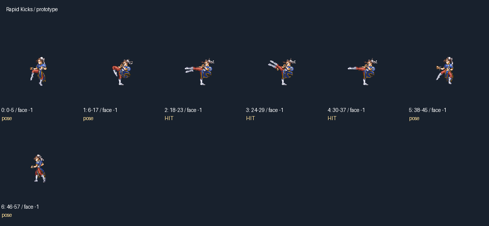
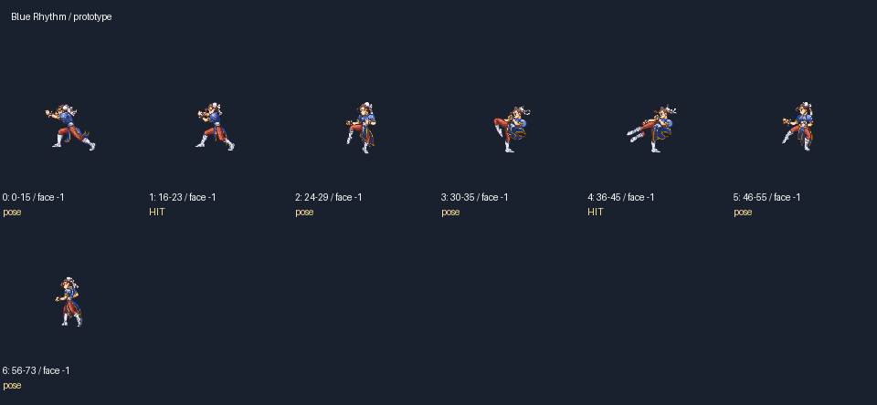
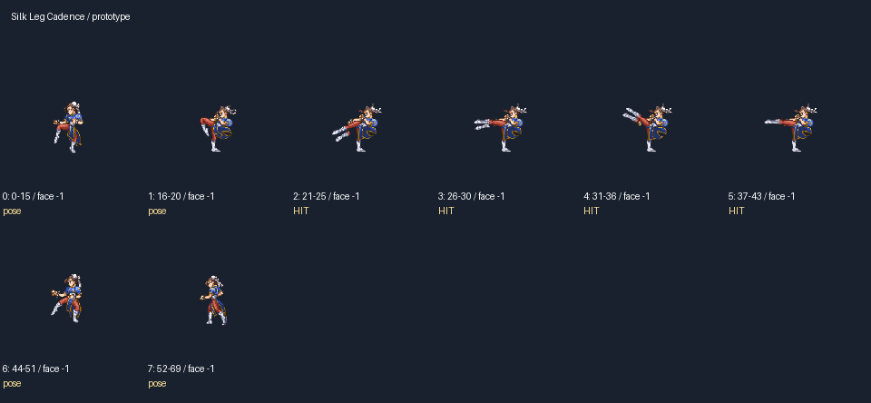
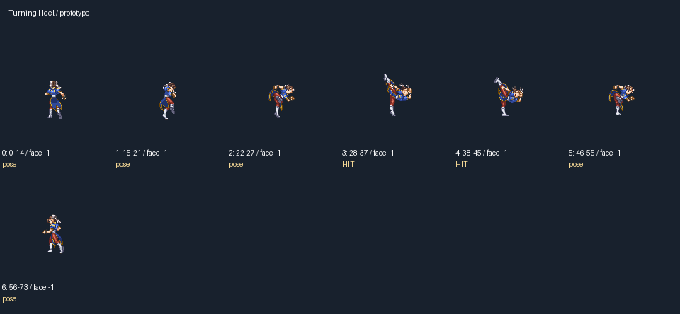
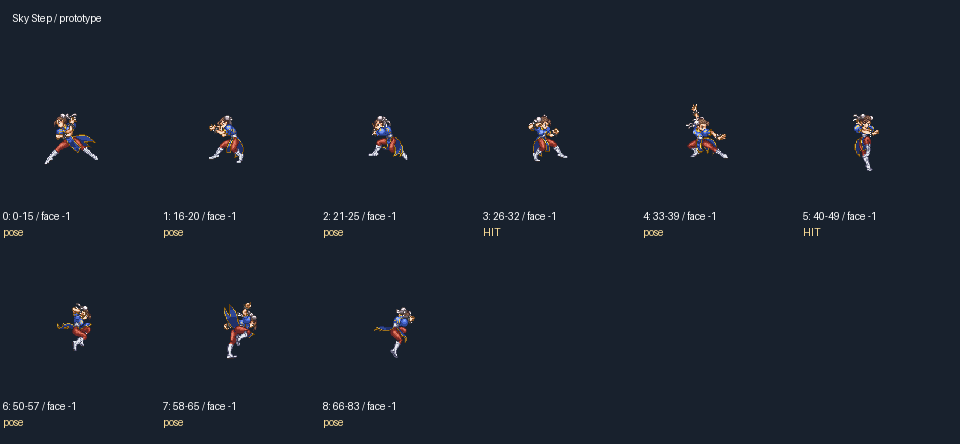
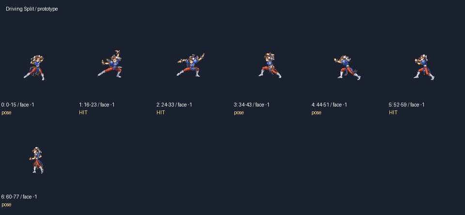
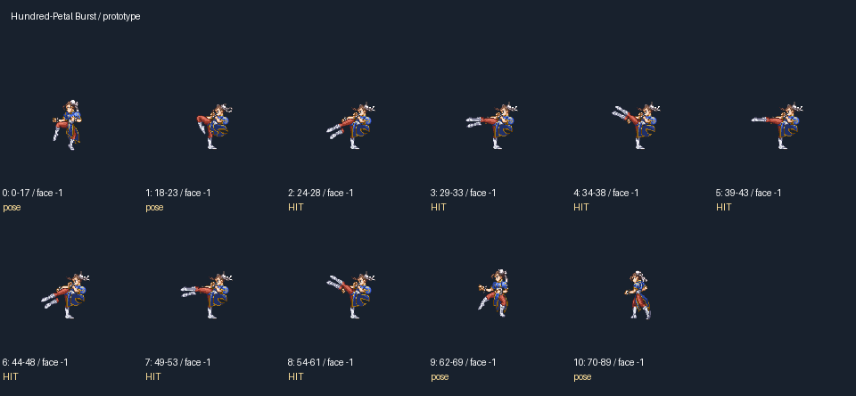
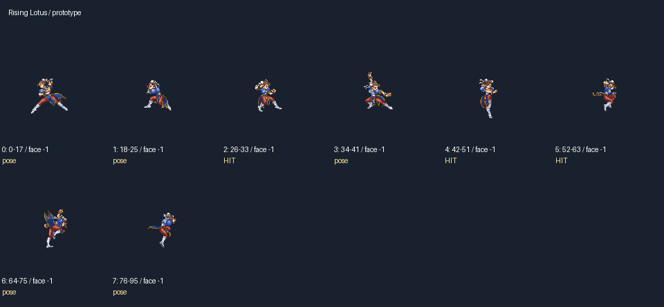
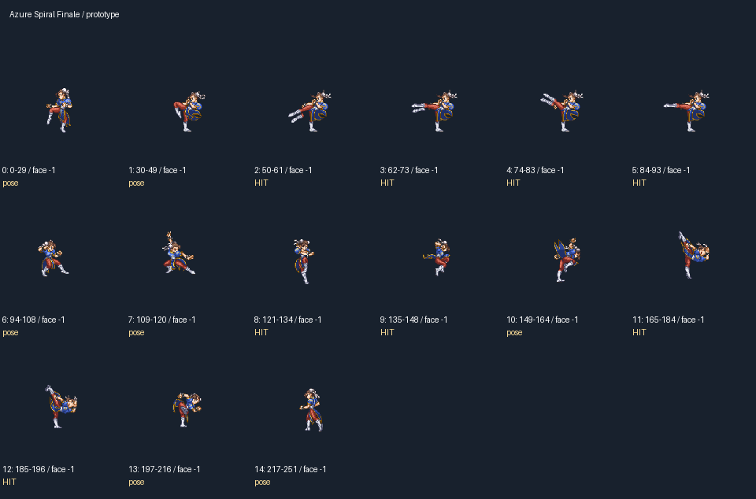

# Choreography review: chunli

These cards expose pose order, timing and event placement. They do not certify visual quality. Review anticipation, actual contact, target reaction and recovery at full and quarter speed.

## Rapid Kicks / prototype
7 pose beats; 7 unique poses; 3 contact events. Status: NEEDS VISUAL SIGN-OFF.

## Blue Rhythm / prototype
7 pose beats; 7 unique poses; 2 contact events. Status: NEEDS VISUAL SIGN-OFF.

## Silk Leg Cadence / prototype
8 pose beats; 8 unique poses; 4 contact events. Status: NEEDS VISUAL SIGN-OFF.

## Turning Heel / prototype
7 pose beats; 7 unique poses; 2 contact events. Status: NEEDS VISUAL SIGN-OFF.

## Sky Step / prototype
9 pose beats; 9 unique poses; 2 contact events. Status: NEEDS VISUAL SIGN-OFF.

## Driving Split / prototype
7 pose beats; 7 unique poses; 3 contact events. Status: NEEDS VISUAL SIGN-OFF.

## Hundred-Petal Burst / prototype
11 pose beats; 8 unique poses; 7 contact events. Status: NEEDS VISUAL SIGN-OFF.

## Rising Lotus / prototype
8 pose beats; 8 unique poses; 3 contact events. Status: NEEDS VISUAL SIGN-OFF.

## Azure Spiral Finale / prototype
15 pose beats; 15 unique poses; 8 contact events. Status: NEEDS VISUAL SIGN-OFF.

